<div align="center">

# AdonisJS Starter Kit

**Full-stack TypeScript monorepo template: AdonisJS 7 API + React SPA, typed end to end.**

English · [Português](README.pt-BR.md)

[](https://github.com/enzopita/adonisjs-starter-kit/actions/workflows/ci.yml)


</div>

<p align="center">
  <picture>
    <source media="(prefers-color-scheme: dark)" srcset="docs/images/members-dark.png">
    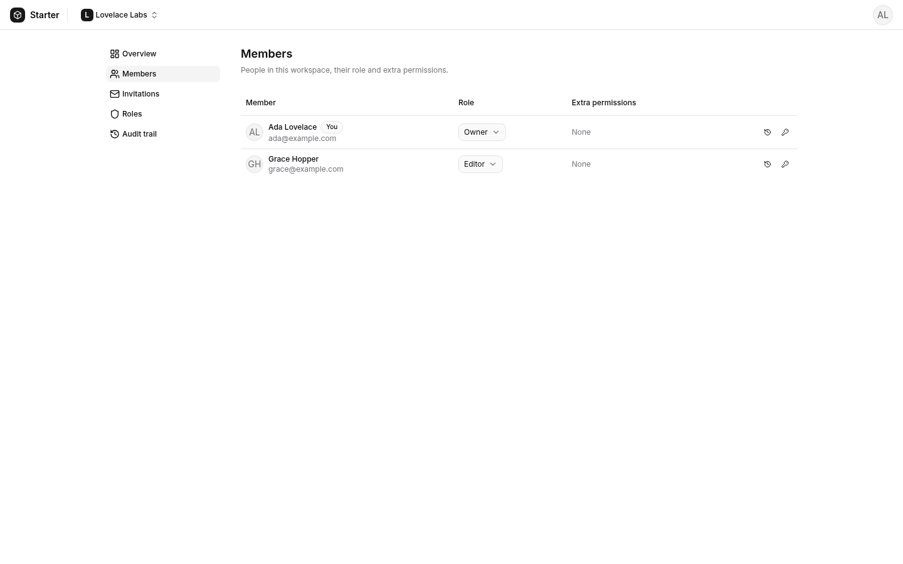
  </picture>
</p>

## Screenshots

|                                                                                            |                                                                                                                                            |
| ------------------------------------------------------------------------------------------ | ------------------------------------------------------------------------------------------------------------------------------------------ |
| 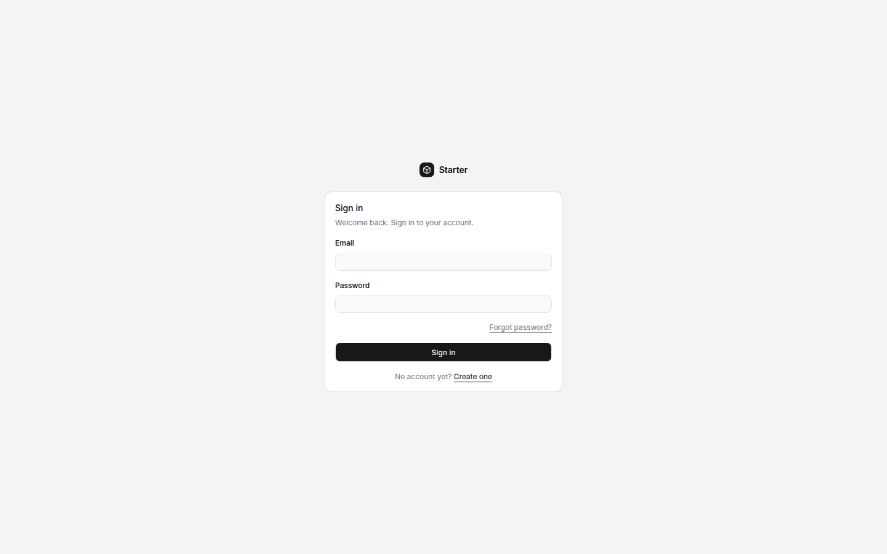 Sign-in                                           | 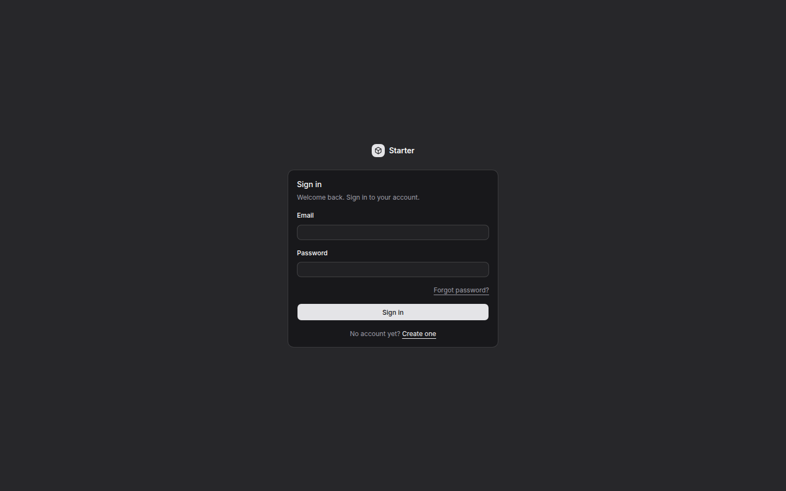 Sign-in, dark theme                                                        |
| 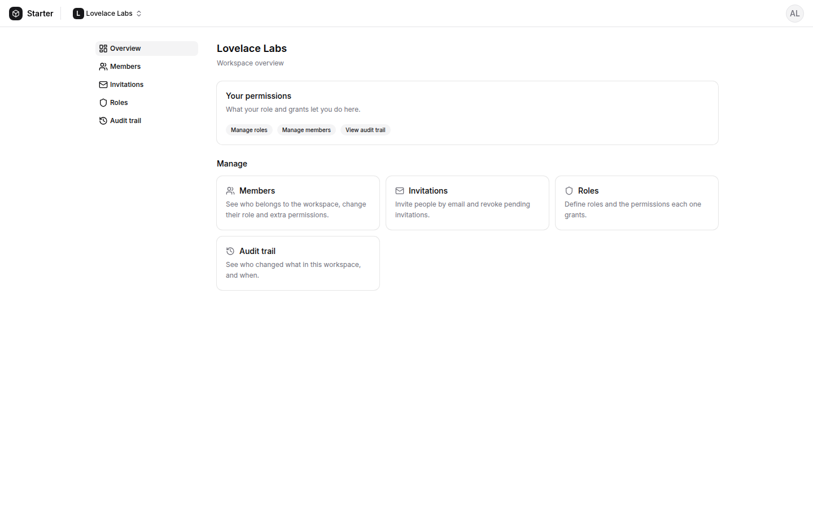 Workspace overview               | 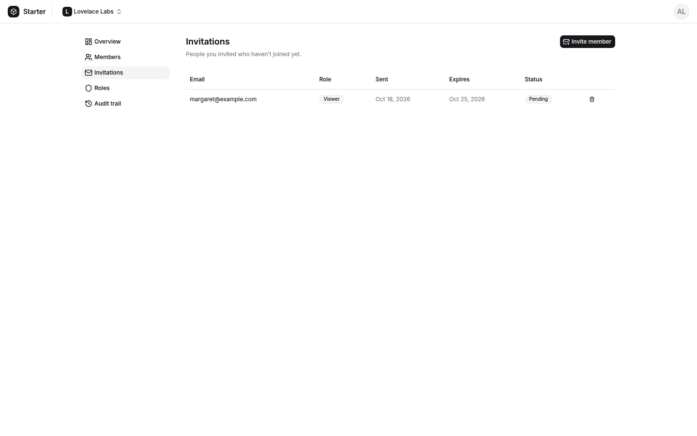 Pending invitations                                                                            |
| 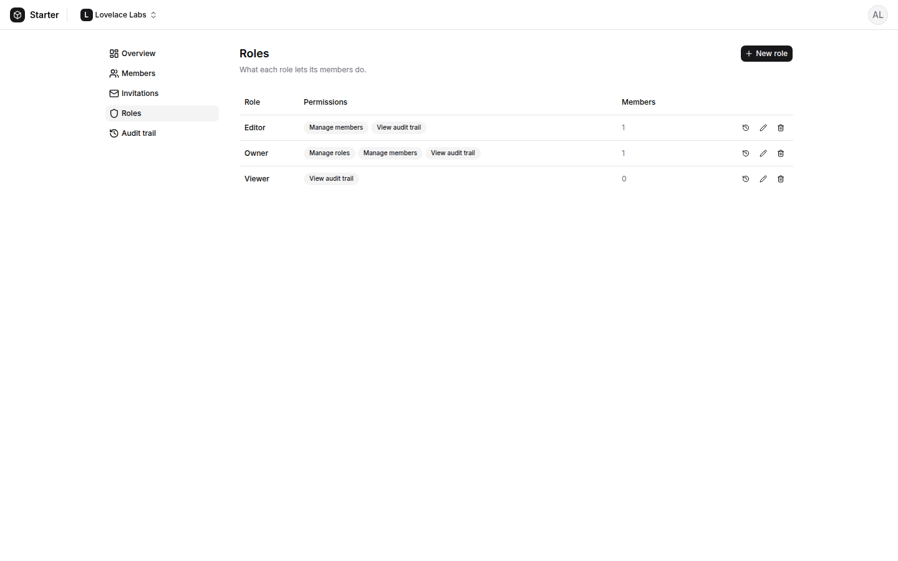 Roles and permissions          | 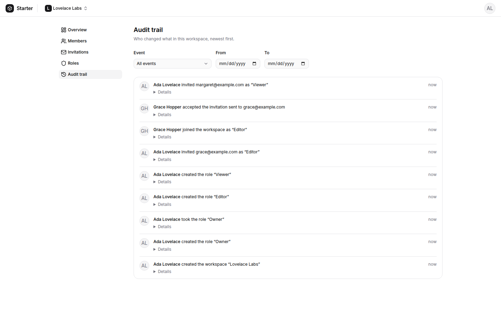 Audit trail                                                                                    |
| 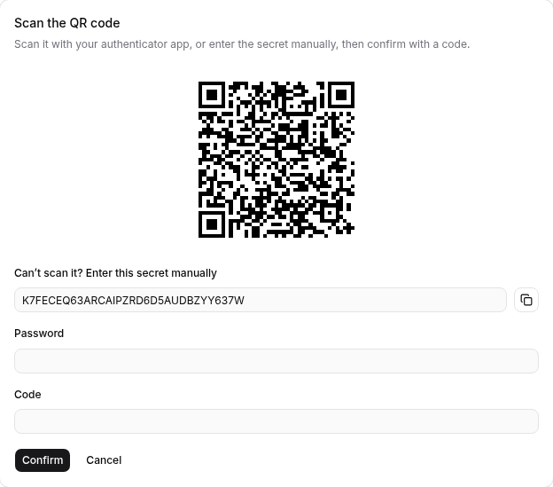 Two-factor setup                     | 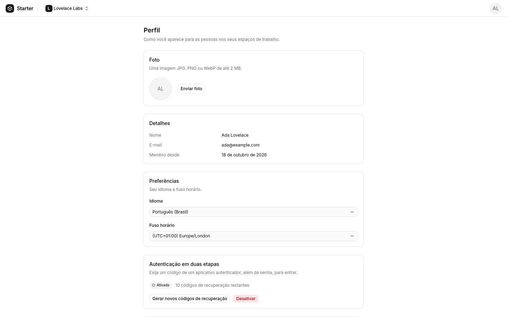 Profile in Portuguese (pt-BR). Each user picks a language and time zone |
| 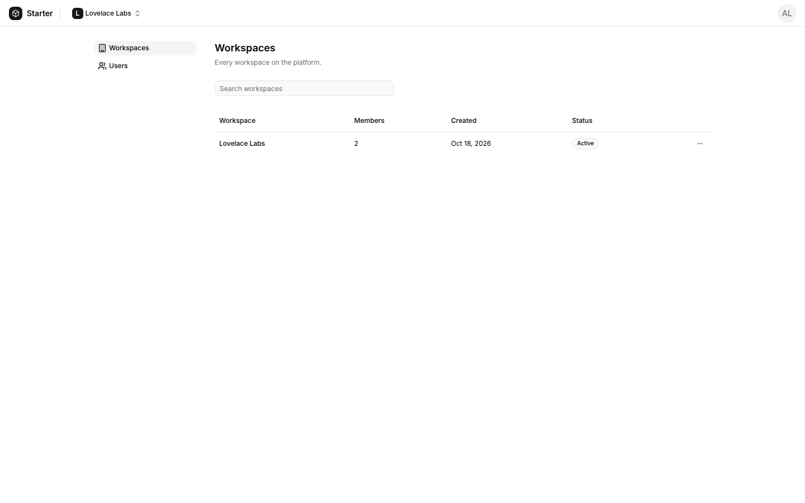 Platform admin, workspaces | 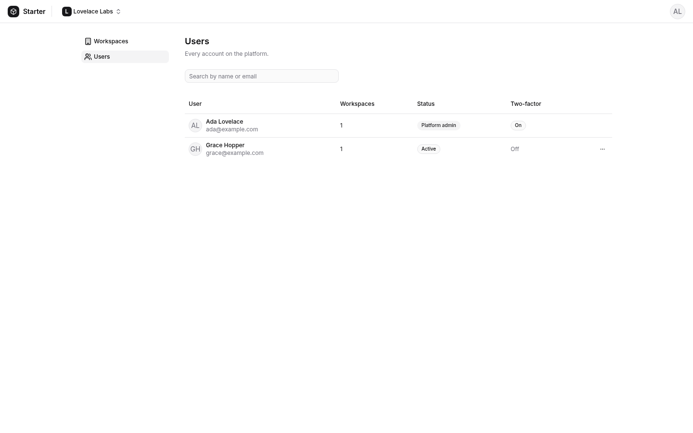 Platform admin, users                                                                |

To retake these screenshots, run `pnpm screenshots`. The script seeds a separate `starter_demo` database, so your dev data stays out of the pictures. It needs Docker, [`agent-browser`](https://www.npmjs.com/package/agent-browser) on the `PATH`, and free ports 3333 and 5173. It also deletes the demo addresses' mail from Mailpit.

## Stack

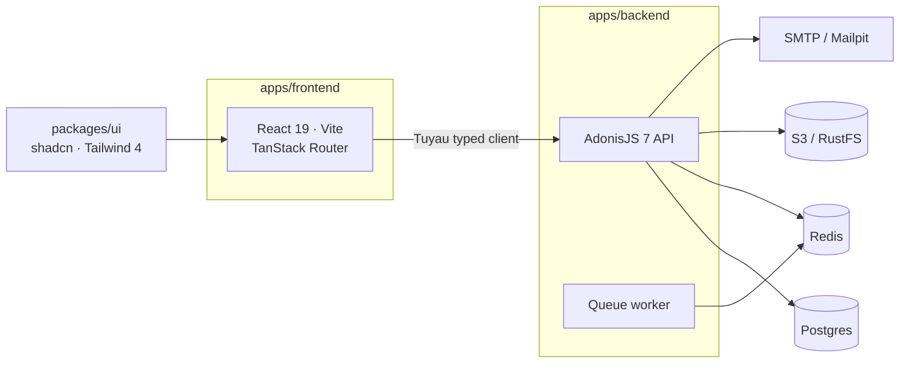

| Workspace       | What                                                              |
| --------------- | ----------------------------------------------------------------- |
| `apps/backend`  | AdonisJS 7 · Lucid · VineJS · auth · Drive/S3 · Mail · queues     |
| `apps/frontend` | React 19 · Vite · TanStack Router · Tuyau client                  |
| `packages/ui`   | Shared design system (shadcn on Base UI, Tailwind 4)              |
| `tests/`        | End-to-end tests (Playwright + agent)                             |
| `docs/`         | [Architecture](docs/architecture.md) · [Testing](docs/testing.md) |

## Included

|     | Feature                                                                   |
| --- | ------------------------------------------------------------------------- |
| 🔐  | Signup, login, email verification, password reset, profile and avatar     |
| 🔑  | Two-factor authentication (TOTP + recovery codes) and per-device sessions |
| 🏢  | Multi-tenancy with workspaces and invitations by email                    |
| 🛡️  | Roles and fine-grained permissions per workspace                          |
| 📜  | Audit trail of who changed what in a workspace, and when                  |
| 🛠️  | Platform admin area for every workspace and user, behind 2FA              |
| 🌐  | i18n (en-US, pt-BR) with per-user language and time zone preferences      |
| 📎  | Attachments on S3 with signed URLs and orphan cleanup                     |
| ✉️  | Mail (Mailpit in dev) and Redis queues                                    |
| ❤️  | Health checks (`/health/live`, `/health/ready`)                           |
| 🧬  | UUIDv7 primary keys, env validated at boot                                |
| 🧪  | Unit, functional and e2e tests                                            |
| 🧹  | oxlint + oxfmt, module boundaries enforced, Conventional Commits          |
| 🐳  | Multi-stage Dockerfile and a Dokploy compose file                         |

## Modules

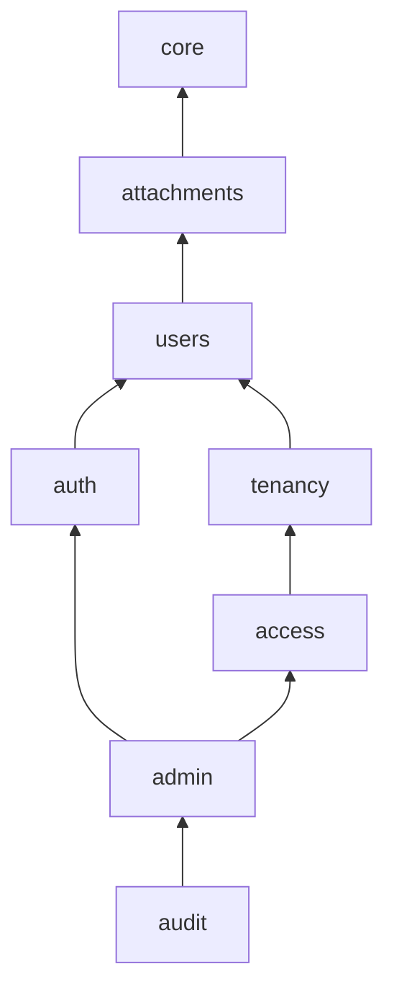

Arrows are allowed imports, declared in [`apps/backend/modules.json`](apps/backend/modules.json) and enforced by the lint. The diagram leaves out an arrow when a longer path already shows it. The file lists every one.

## Quick start

> Requires **Node 24**, **pnpm** via Corepack (`corepack enable`) and **Docker**.

```sh
git clone --depth 1 https://github.com/enzopita/adonisjs-starter-kit.git my-app
cd my-app && rm -rf .git && git init
```

Rename the project: `APP_NAME` in `apps/backend/.env.example` and `DB_DATABASE=<APP_NAME>_test` in `apps/backend/.env.test`.

```sh
pnpm install
cp apps/backend/.env.example apps/backend/.env
cp apps/frontend/.env.example apps/frontend/.env
(cd apps/backend && node ace generate:key)

pnpm dev
(cd apps/backend && node ace migration:run)
```

| Service  | URL                                  |
| -------- | ------------------------------------ |
| Frontend | http://localhost:5173                |
| API      | http://localhost:3333/api/v1         |
| Mailpit  | http://localhost:8025                |
| RustFS   | http://localhost:9001/rustfs/console |

## Scripts

| Command                        | Does                                     |
| ------------------------------ | ---------------------------------------- |
| `pnpm dev`                     | Containers + API, worker and frontend    |
| `pnpm build`                   | Production build                         |
| `pnpm test` · `pnpm test:e2e`  | Backend tests · end-to-end tests         |
| `pnpm typecheck` · `pnpm lint` | Type check · lint                        |
| `pnpm format`                  | Format                                   |
| `pnpm codegen`                 | Regenerate typed client and registries   |
| `pnpm screenshots`             | Retake the README screenshots            |
| `node ace make:module <name>`  | New backend module (from `apps/backend`) |

## Deploy

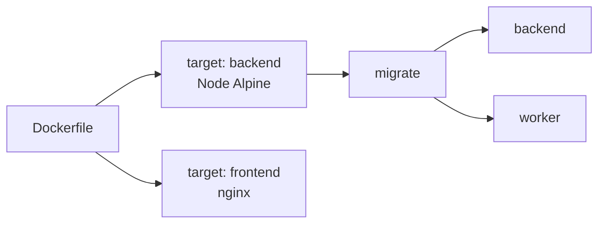

See [`compose.dokploy.yaml`](compose.dokploy.yaml) for [Dokploy](https://dokploy.com).

## Docs

[AdonisJS](https://docs.adonisjs.com) · [Lucid](https://lucid.adonisjs.com) · [VineJS](https://vinejs.dev) · [Tuyau](https://docs.adonisjs.com/guides/frontend/api-client) · [TanStack Router](https://tanstack.com/router) · [shadcn/ui](https://ui.shadcn.com) · [Tailwind](https://tailwindcss.com) · [Japa](https://japa.dev)

AI coding agents: see [`AGENTS.md`](AGENTS.md).
