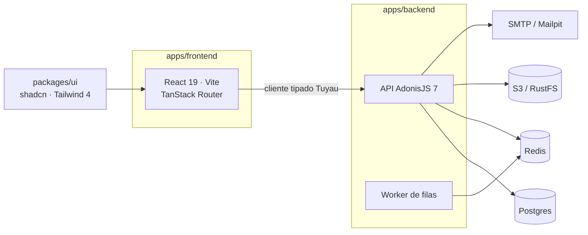
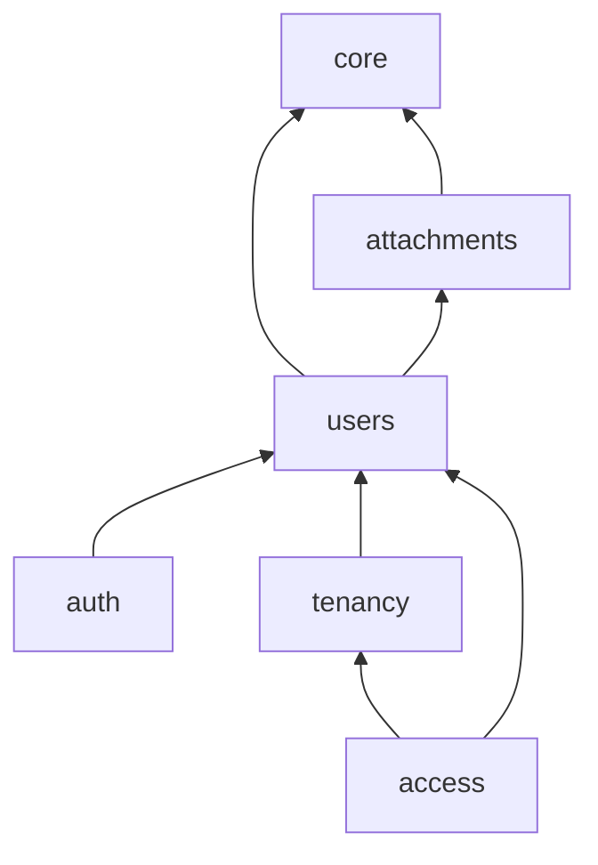
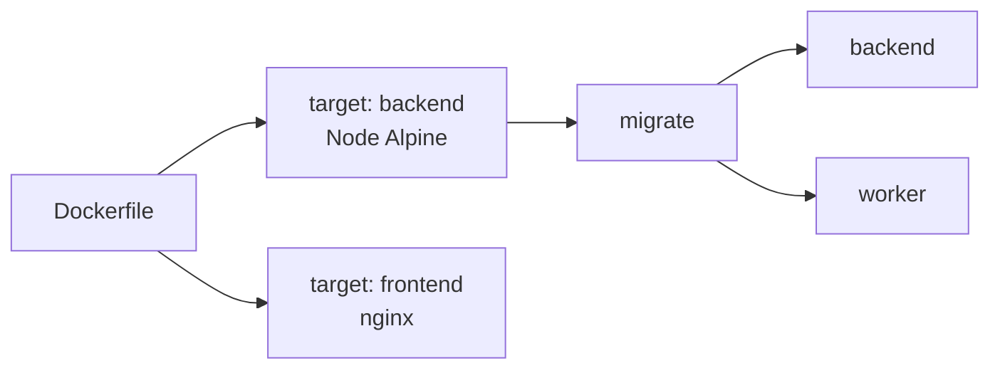

<div align="center">

# Starter

**Template de monorepo full-stack em TypeScript: API AdonisJS 7 + SPA React, tipado de ponta a ponta.**

[English](README.md) · Português


</div>

## Stack



| Workspace       | O que é                                                         |
| --------------- | --------------------------------------------------------------- |
| `apps/backend`  | AdonisJS 7 · Lucid · VineJS · auth · Drive/S3 · Mail · filas    |
| `apps/frontend` | React 19 · Vite · TanStack Router · cliente Tuyau               |
| `packages/ui`   | Design system compartilhado (shadcn sobre Base UI, Tailwind 4)  |
| `tests/`        | Testes end-to-end (Playwright + agente)                         |
| `docs/`         | [Arquitetura](docs/architecture.md) · [Testes](docs/testing.md) |

## O que vem pronto

|     | Recurso                                                            |
| --- | ------------------------------------------------------------------ |
| 🔐  | Cadastro, login, perfil e avatar (guards de token e sessão)        |
| 🏢  | Multi-tenancy                                                      |
| 🛡️  | Papéis e permissões por tenant                                     |
| 📎  | Anexos no S3 com URLs assinadas e limpeza de órfãos                |
| ✉️  | E-mail (Mailpit em dev) e filas no Redis                           |
| ❤️  | Health checks (`/health/live`, `/health/ready`)                    |
| 🧬  | Chaves primárias UUIDv7, env validado no boot                      |
| 🧪  | Testes unitários, funcionais e e2e                                 |
| 🧹  | oxlint + oxfmt, fronteiras de módulo no lint, Conventional Commits |
| 🐳  | Dockerfile multi-stage e compose para Dokploy                      |

## Módulos



As setas são os imports permitidos, declarados em [`apps/backend/modules.json`](apps/backend/modules.json) e aplicados pelo lint.

## Começando

> Requer **Node 24**, **pnpm** via Corepack (`corepack enable`) e **Docker**.

```sh
git clone --depth 1 https://github.com/enzopita/starter.git meu-app
cd meu-app && rm -rf .git && git init
```

Dê um nome ao projeto: `APP_NAME` em `apps/backend/.env.example` e `DB_DATABASE=<APP_NAME>_test` em `apps/backend/.env.test`.

```sh
pnpm install
cp apps/backend/.env.example apps/backend/.env
cp apps/frontend/.env.example apps/frontend/.env
(cd apps/backend && node ace generate:key)

pnpm dev
(cd apps/backend && node ace migration:run)
```

| Serviço  | URL                                  |
| -------- | ------------------------------------ |
| Frontend | http://localhost:5173                |
| API      | http://localhost:3333/api/v1         |
| Mailpit  | http://localhost:8025                |
| RustFS   | http://localhost:9001/rustfs/console |

## Scripts

| Comando                        | Faz                                        |
| ------------------------------ | ------------------------------------------ |
| `pnpm dev`                     | Containers + API, worker e frontend        |
| `pnpm build`                   | Build de produção                          |
| `pnpm test` · `pnpm test:e2e`  | Testes do backend · testes end-to-end      |
| `pnpm typecheck` · `pnpm lint` | Typecheck · lint                           |
| `pnpm format`                  | Formatação                                 |
| `pnpm codegen`                 | Regenera o cliente tipado e os registros   |
| `node ace make:module <nome>`  | Novo módulo do backend (em `apps/backend`) |

## Deploy



Veja [`compose.dokploy.yaml`](compose.dokploy.yaml) para o [Dokploy](https://dokploy.com).

## Docs

[AdonisJS](https://docs.adonisjs.com) · [Lucid](https://lucid.adonisjs.com) · [VineJS](https://vinejs.dev) · [Tuyau](https://docs.adonisjs.com/guides/frontend/api-client) · [TanStack Router](https://tanstack.com/router) · [shadcn/ui](https://ui.shadcn.com) · [Tailwind](https://tailwindcss.com) · [Japa](https://japa.dev)

Agentes de código: veja o [`AGENTS.md`](AGENTS.md).
